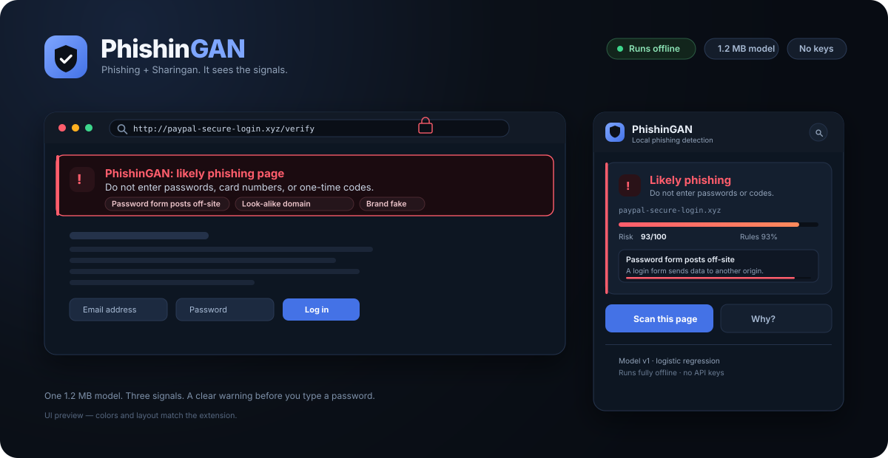
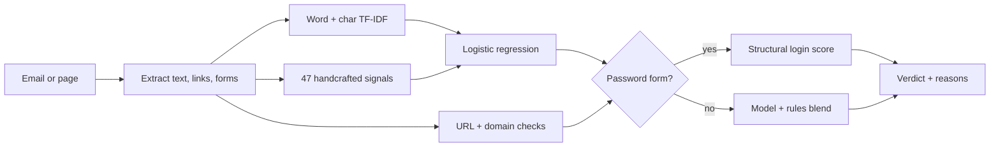

# PhishinGAN

<div align="center">
  
</div>

<div align="center">

**Phishing + Sharingan. It sees the signals.**

A local-first browser extension that warns you before you type a password into a phishing page or trust a scam email.
No API keys. No accounts. No page text leaves your browser.

[](https://github.com/Daemon-018/phishingan/actions/workflows/tests.yml)
[](pyproject.toml)
[](tests)
[](#install)
[](#firefox)
[](#privacy)
[](LICENSE)
[](https://github.com/Daemon-018/phishingan/releases/latest)

</div>

---

## What it does

PhishinGAN reads the page in front of you and answers one question:

> **“Is this page trying to steal something?”**

It looks at three things:

1. **What the text is saying** — urgency, threats, credential requests, polished LLM-style phrasing.
2. **What the links and domains look like** — look-alike brands, punycode, raw IPs, URL shorteners, cheap TLDs.
3. **What the page is doing** — especially whether a password form posts credentials to another website.

Then it gives you a **green / yellow / red** verdict with a plain-English **“why”**.

| | Verdict | What you should do |
|---|---|---|
| 🟢 | **No phishing signals** | Nothing looked like a credential attack. Keep normal caution. |
| 🟡 | **Suspicious** | Some signals look wrong. Verify the sender/domain through a channel you trust. |
| 🔴 | **Likely phishing** | Do not enter passwords, card numbers, or one-time codes. Close the page. |

The whole detector is a **1.2 MB** model that runs in JavaScript inside the extension. A scan takes **3–9 ms** on CPU, with no network request.

---

## Why the name?

**PhishinGAN** = **phishing** + **Sharingan** (the eye that sees through illusions), with a nod to **GANs** because the project is about machine-written phishing.

The detector does not try to answer *“was this written by AI?”* — that is a losing game. It answers *“does this message or page have phishing intent?”*, which stays useful whether a human, GPT, or the next model wrote it.

---

## Install

### The short version

The trained model is already included in `extension/model/model.json`. **You do not need Python, a GPU, or any API key to use the extension.**

**Fastest install:** open the [latest release](https://github.com/Daemon-018/phishingan/releases/latest), download the bundle for your browser, unzip it, then load the unzipped folder as described below.

Or clone the repo:

```bash
git clone https://github.com/Daemon-018/phishingan.git
cd phishingan
```

Or download the source ZIP from GitHub: **Code → Download ZIP**, then unzip it.

---

### Chrome, Edge, Brave, Opera, Vivaldi

These browsers all support the same Manifest V3 folder.

1. Open your browser’s extensions page:

   | Browser | Address |
   |---|---|
   | Chrome | `chrome://extensions` |
   | Edge | `edge://extensions` |
   | Brave | `brave://extensions` |
   | Opera | `opera://extensions` |
   | Vivaldi | `vivaldi://extensions` |

2. Turn on **Developer mode**.
3. Click **Load unpacked**.
4. Select the **`extension`** folder from this repo (the one containing `manifest.json`). If you downloaded a release bundle, select the unzipped **`phishingan-chrome`** folder instead.
5. Pin **PhishinGAN** to the toolbar.

That’s it. Open Gmail or any login page, or click the icon and press **Scan this page**.

> **Permission notice:** your browser will say the extension can “read and change all your data on all websites.” That is how every page-reading extension works. PhishinGAN only reads text, links, and form structure, and it never uploads or stores page content. You can limit access in the extension’s **Site access** settings.

---

### Firefox

Firefox needs a slightly different manifest because it uses background scripts instead of a service worker.

1. Open `about:debugging#/runtime/this-firefox`.
2. Click **Load Temporary Add-on…**
3. Select **`extension/manifest.firefox.json`** from a clone, or **`manifest.json`** inside the unzipped `phishingan-firefox` release folder.

The extension stays loaded until Firefox restarts. This is the simplest way to try it.

For a **permanent** Firefox install:

```bash
python scripts/build_extension.py
```

Then either:

- submit `dist/phishingan-firefox.zip` to [addons.mozilla.org](https://addons.mozilla.org/developers/) for signing, or
- use Firefox Developer Edition / Nightly with signature enforcement disabled for local testing.

Temporary add-ons are unsigned by design; release Firefox will not install an unsigned extension permanently.

---

### Build shareable ZIPs

```bash
python scripts/build_extension.py
```

Output:

```text
dist/phishingan-chrome.zip      # Chrome, Edge, Brave, Opera, Vivaldi
dist/phishingan-firefox.zip     # Firefox / AMO submission
dist/phishingan-chrome/         # unpacked Chrome build
dist/phishingan-firefox/        # unpacked Firefox build
```

Only the Python standard library is needed for the build — no virtualenv required.

---

### Safari

Not supported out of the box. Safari extensions need Apple’s `safari-web-extension-converter`, Xcode, and a developer account, and the background/storage APIs differ enough that this build has not been tested there. Treat Safari as a future port, not a current target.

---

## Using it

### Automatic

PhishinGAN auto-scans when it has something meaningful to read:

- **Webmail** — Gmail, Outlook, Yahoo Mail, Proton Mail, Zoho Mail. It waits for an actual message body, not the inbox list.
- **Login pages** — pages containing a password field.

A banner appears at the top of the page if anything looks wrong. Click **Rescan** after the page changes, or **×** to dismiss it.

### Manual

On any other page:

1. Click the PhishinGAN icon.
2. Press **Scan this page**.

The popup shows:

- the verdict and risk score,
- model vs. rule contribution,
- the top reasons, ranked by strength,
- risky links (defanged, never opened),
- the raw signal breakdown under **Signals**.

### Settings

Open the gear in the popup:

- **Auto-scan** — check webmail and login pages automatically.
- **Desktop alerts** — show a notification for high-risk pages.

Settings are stored locally with `chrome.storage.local`.

---

## How it works



### 1. Text model

- **30,000 word features** — unigrams and bigrams, TF-IDF weighted.
- **15,000 character features** — 3–4 character n-grams, useful for obfuscation and non-standard spelling.
- **47 handcrafted features** — intent lexicons (urgency, threats, credentials, rewards, calls to action), stylometry, HTML/URL shape.
- **Logistic regression** — small, fast, calibrated, and easy to explain.

Training data: **21,114 messages** from two corpora (human-written and LLM-generated), split into train/validation/test.

### 2. Rules and URLs

A deterministic rule engine adds evidence such as:

- “Requests credentials or payment data”
- “Creates artificial urgency”
- “Threatens account loss”
- “Link imitates the brand PayPal”
- “Link uses a punycode domain”
- “Password form posts to a different website”

For email and normal pages, the final score is a blend:

```text
email:       80% model + 20% rules
normal page: 70% model + 30% rules
login page:  100% structural evidence
```

### 3. Why login pages are special

A real bank login page *also* says “Enter your password.” If the email-trained text model judged it, every legitimate login page would look like phishing.

So when a password field is present, PhishinGAN ignores the credential wording and judges:

- Is the domain actually the brand it claims to be?
- Is it a look-alike, punycode, or high-abuse domain?
- Does the password form submit to another origin?
- Is the page served over HTTPS?

That is why a real `paypal.com` login stays quiet while `paypal-secure-login.xyz` is flagged.

### 4. Explainability

The popup shows the exact signals that moved the score:

- token contributions from the logistic regression,
- handcrafted-feature contributions,
- rule matches,
- structural URL flags.

No “the AI said so.” The reasoning is inspectable, and the raw numbers are under **Signals**.

---

## Results

Held-out test set, threshold selected on validation:

| Metric | Overall | Classic | LLM-generated |
|---|---:|---:|---:|
| Rows | 3,168 | 2,606 | 562 |
| Accuracy | **99.05%** | 98.89% | 99.82% |
| Precision | **98.88%** | 98.55% | 99.73% |
| Recall | **98.88%** | 98.44% | 100.00% |
| F1 | **98.88%** | 98.50% | 99.87% |
| ROC-AUC | **99.87%** | 99.84% | 100.00% |
| False-positive rate | **0.82%** | 0.85% | 0.52% |

### The interesting experiment

Does a detector trained only on human-written phishing catch LLM-written phishing?

| Trained on | Tested on | Recall | False-positive rate | ROC-AUC |
|---|---|---:|---:|---:|
| Classic only | LLM phishing | 81.13% | **61.26%** | 65.14% |
| LLM only | Classic phishing | 45.54% | 20.58% | 66.59% |
| Combined | Both | **98.88%** | **0.82%** | **99.87%** |

A classic-only detector flags **61% of legitimate LLM-written emails** as phishing. The writing style is different enough that “sounds like phishing” and “sounds like an LLM” become the same signal. Training on both sources fixes the failure.

### Honest caveats

- The LLM corpus is **synthetic and very uniform** (~1,500 characters per email). The near-perfect LLM numbers probably reflect generation artifacts, not real-world robustness.
- The classic corpus is old (Enron-era legitimate mail). Modern business email looks different.
- These are **offline text metrics**, not live-browser metrics. The extension adds structural page signals, but the two are not the same benchmark.
- A false positive means a legitimate message gets a yellow or red warning. The **“suspicious”** band exists for exactly that reason: it is a hint, not proof.

Full reports: [`reports/metrics.json`](reports/metrics.json) and [`reports/experiments.json`](reports/experiments.json).

---

## Python API and web demo

You only need this if you want to retrain, inspect, or use the model outside the browser.

```bash
python -m venv .venv
source .venv/bin/activate          # Windows: .venv\Scripts\activate
pip install -e ".[dev]"
```

The trained model is included, so the demo works immediately:

```bash
phishingan serve
# open http://127.0.0.1:8000
```

### CLI

```bash
phishingan scan --text "Your account will be suspended. Verify your password at http://paypal-secure-login.xyz/verify"
phishingan scan --file suspicious.eml --json
phishingan evaluate --experiments
```

### HTTP API

```bash
curl -s http://127.0.0.1:8000/api/scan \
  -H 'content-type: application/json' \
  -d '{"text":"Verify your account within 24 hours at http://paypal-secure-login.xyz"}'
```

Endpoints:

- `POST /api/scan` — `{ "text": "...", "html": "..." }`
- `GET /api/samples` — built-in demo messages
- `GET /api/health` — model availability
- `GET /docs` — interactive OpenAPI docs

### Retrain from scratch

```bash
phishingan build-data      # downloads both corpora, cleans, dedupes, splits
phishingan train           # fits the model, selects a threshold, writes reports
phishingan evaluate --experiments
python scripts/export_model.py
```

`export_model.py` regenerates `extension/model/model.json`, the weights the JavaScript engine uses.

---

## Project layout

```text
phishingan/
├── extension/                  # the browser extension
│   ├── manifest.json           # Chrome / Edge / Brave / Opera / Vivaldi
│   ├── manifest.firefox.json   # Firefox variant
│   ├── background.js           # service worker / background script
│   ├── content.js              # page extraction + warning banner
│   ├── popup.html/css/js       # toolbar popup
│   ├── lib/phishingan.js       # JS scoring engine (TF-IDF + logistic regression)
│   ├── model/model.json        # exported model, ~1.2 MB
│   └── icons/
├── src/phishingan/             # Python package
│   ├── data.py                 # download, clean, split
│   ├── features/               # signals, URLs, feature matrix
│   ├── model.py                # training, evaluation, experiments
│   ├── explain.py              # token/feature/sentence explanations
│   ├── scanner.py              # model + rules + URLs
│   ├── api.py                  # FastAPI app
│   ├── cli.py                  # phishingan command
│   └── web/                    # demo UI
├── scripts/                    # export, build, parity and browser tests
├── tests/                      # 24 pytest tests
├── reports/                    # metrics and cross-source experiments
└── docs/preview.svg            # UI preview
```

---

## Tests

```bash
# Python: data invariants, URLs, signals, explanations, scanner, API
pytest -q

# JavaScript: model parity + page scenarios
npm install
node scripts/test_page_scenarios.mjs
node scripts/test_content_dom.mjs

# Full JS ↔ Python parity (needs the processed dataset)
phishingan build-data
PYTHONPATH=src python scripts/make_js_validation.py
node scripts/validate_js_model.mjs
```

Current state:

- **24/24 Python tests pass.**
- **66/66 parity cases** match Python within **2 × 10⁻⁵** max absolute difference.
- DOM tests cover Gmail extraction, inbox suppression, cross-origin forms, and same-brand forms.
- Scenario tests cover real PayPal/Microsoft/Google logins, look-alike domains, punycode, cheap TLDs, private-IP routers, and normal articles.

---

## Datasets and credits

This project would not exist without these public corpora:

- **Classic phishing email dataset** — [`zefang-liu/phishing-email-dataset`](https://huggingface.co/datasets/zefang-liu/phishing-email-dataset)
- **LLM-generated phishing email dataset** — [`Dizzzy0x00/LLMGen-Phishing-Email-Dataset`](https://huggingface.co/datasets/Dizzzy0x00/LLMGen-Phishing-Email-Dataset)

After cleaning and deduplication:

| Source | Rows |
|---|---:|
| Classic | 17,368 |
| LLM-generated | 3,746 |
| **Total** | **21,114** |

Splits: 14,779 train / 3,167 validation / 3,168 test.

Raw data is **not redistributed** in this repo; `phishingan build-data` downloads it from the original hosts. Each dataset keeps its original license and terms. Please cite the original authors if you reuse them.

Built with [scikit-learn](https://scikit-learn.org), [FastAPI](https://fastapi.tiangolo.com), and plain JavaScript. No external UI assets, no tracking, no telemetry.

---

## Privacy

- **No network calls at scan time.** The model is bundled.
- **No page content is stored.** Results live in `storage.session` (or `storage.local` as a fallback) only so the popup can show the latest result.
- **No API keys, accounts, or tokens.**
- **No analytics.**
- The extension requests `<all_urls>` because it must read text, links, and forms on whichever page you are viewing. Restrict site access in the browser if you prefer.

If you fork this and add a cloud LLM “second opinion,” keep the key on a backend proxy. Never ship an API key inside an extension — anyone can unzip it and read it.

---

## Limitations

- **Not a replacement for 2FA, a password manager, or browser Safe Browsing.** Use all of them.
- **A perfect clone on a hacked legitimate domain is hard to catch.** The URL is real, and the page can look identical. This build cannot see the backend or the visual clone.
- **Login pages are judged structurally.** That avoids false alarms on real login pages, but it also means a flawless fake on a trusted domain can slip through.
- **English-centric training data.** Performance on other languages is unmeasured.
- **The LLM corpus is synthetic.** Treat the near-perfect LLM metrics as a stress-test result, not a promise.
- **False positives happen.** The yellow “suspicious” band is intentionally cautious; dismiss it when you have verified the source.
- **Only webmail and login pages auto-scan.** Other pages are one click away, but not automatic.

---

## Roadmap

- [ ] Optional LLM “second opinion” through a backend proxy (keys never in the extension)
- [ ] Visual similarity and logo detection for cloned login pages
- [ ] Public Suffix List instead of the small built-in suffix table
- [ ] Per-language thresholds and calibration
- [ ] Signed Chrome Web Store and Firefox AMO builds
- [ ] Rule editor / allowlist for power users

---

## License

[MIT](LICENSE). The name and code are independent of any anime franchise; **Sharingan** is used only as a cultural reference in the project name.

<div align="center">
<sub>Built as a learning project from a completed hackathon problem statement.<br>
Not affiliated with PayPal, Microsoft, Google, or any brand shown in the examples.</sub>
</div>
